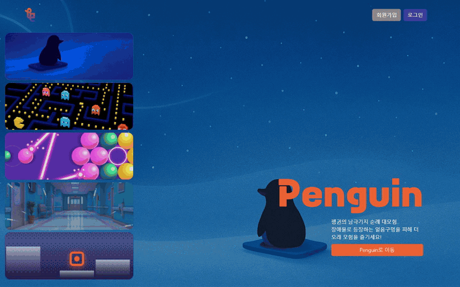
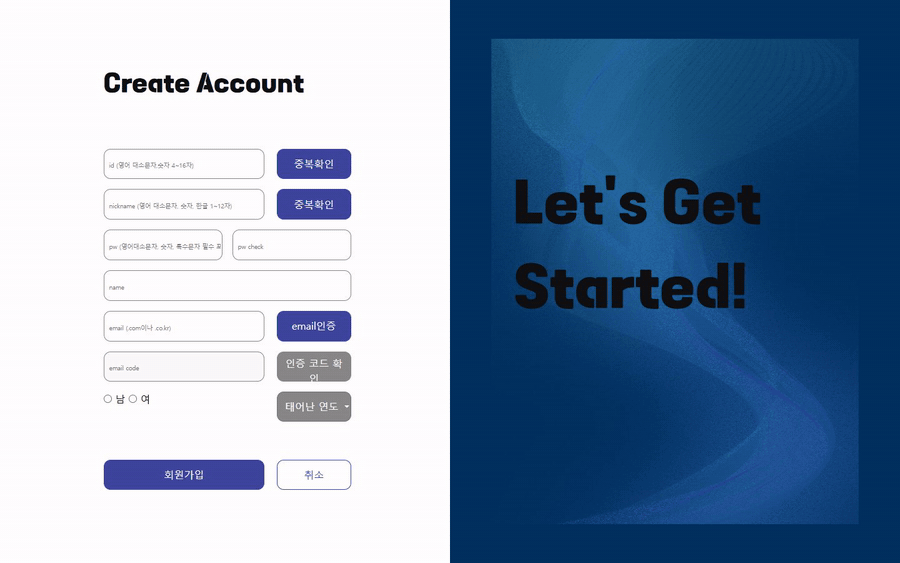
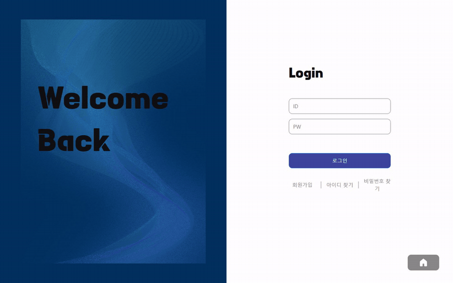
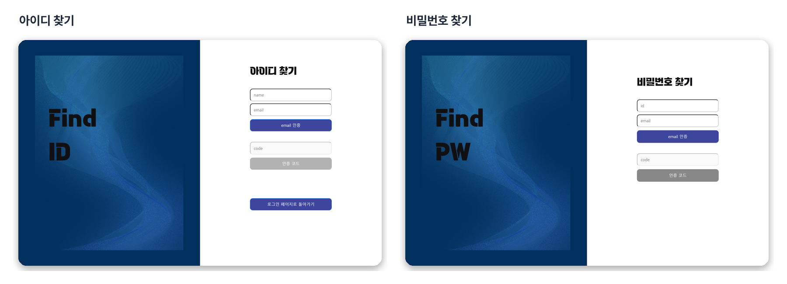
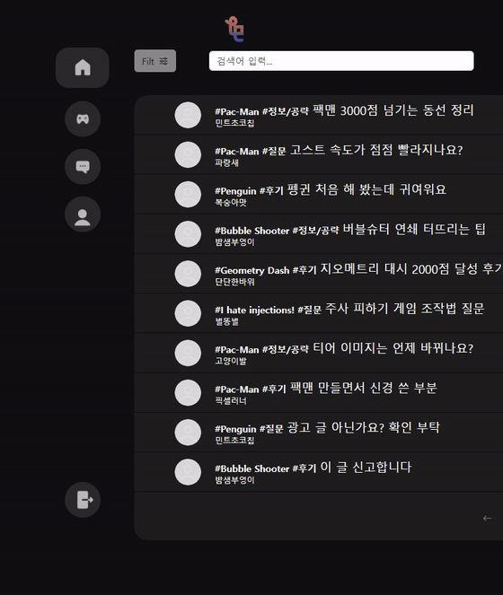
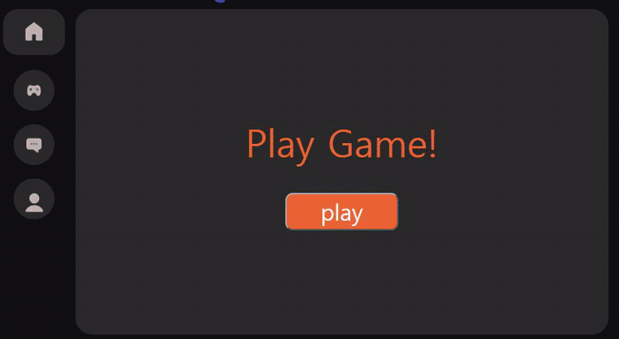
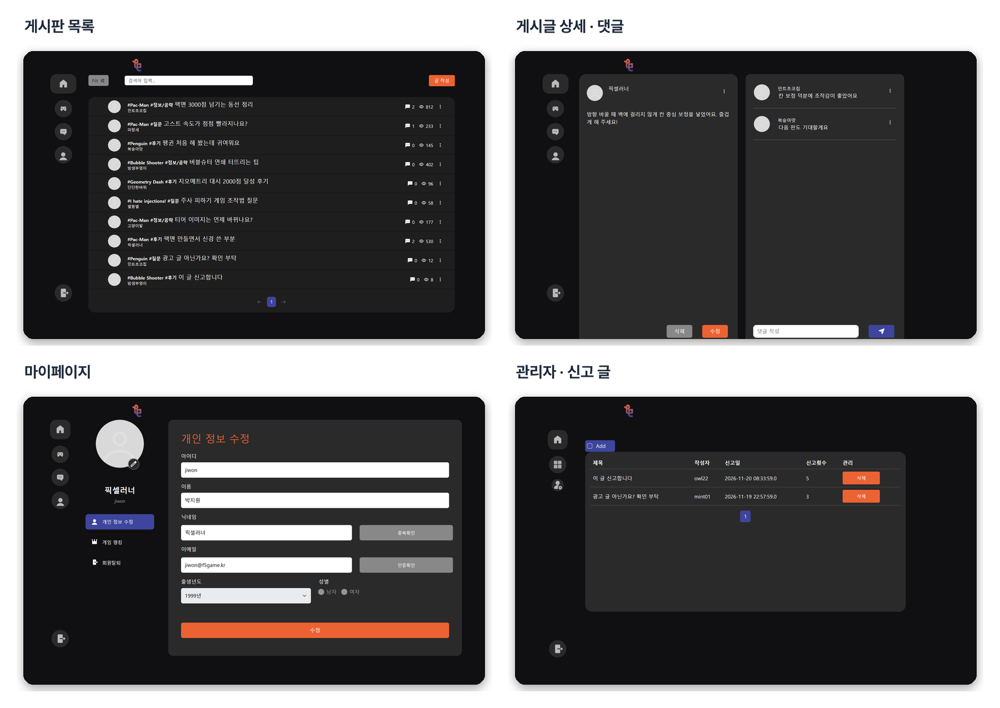
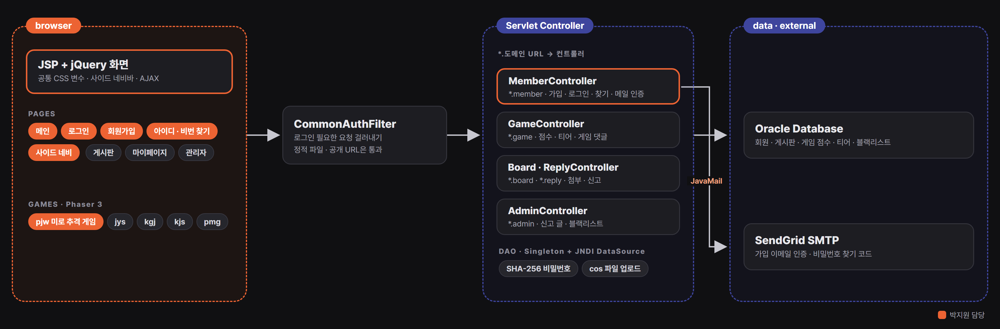

<div align="center">

# 🎮 F5 — 미니게임 허브 웹

**다섯 명이 하나씩 만든 브라우저 게임을 한 사이트에서**

회원가입하고 게임을 플레이하면 점수와 티어가 쌓이고,<br>
게임마다 댓글을 남기고 게시판에서 이야기하는 Java 웹 프로젝트



</div>

<br>

## 0. 담당 파트 — 메인 · 회원 화면, 게임 1개

> 사이트의 첫인상인 **메인 화면**, **로그인 · 회원가입 · 아이디 / 비밀번호 찾기**, 모든 화면에 붙는 **사이드 네비바**를 만들고, 팀 게임 중 **미로 추격 게임** 하나를 맡았습니다.<br>
> JSP · jQuery · CSS · Java Servlet · Phaser 3

| 기능 | 한 일 |
| :--- | :--- |
| **메인 화면** | 게임 카드 목록, 카드 호버 · 선택 시 테두리 효과, 고른 게임 소개를 오른쪽에 펼치는 화면 전환 |
| **회원가입** | 아이디 · 닉네임 · 비밀번호 · 이름 · 이메일 정규식 실시간 검사, 아이디 · 닉네임 중복 확인, 이메일 인증 코드 |
| **로그인 · 찾기** | 로그인, 아이디 찾기(이름 + 이메일), 비밀번호 찾기(이메일 코드 확인 후 변경) |
| **이메일 발송** | SendGrid SMTP로 인증 코드 메일 발송, 계정 정보는 코드가 아니라 톰캣 환경 변수에서 읽기 |
| **사이드 네비바** | 일반 회원용 · 관리자용 사이드 메뉴와 아이콘 |
| **미로 추격 게임** | Phaser 3로 만든 미로 게임, 게임 오버 시 점수를 서버에 저장 |

<br>

## 1. 프로젝트 소개

**F5**는 팀원 다섯 명이 각자 만든 **브라우저 미니게임**을 한 사이트에 모은 게임 허브입니다.

- 메인 화면에서 게임을 골라 바로 플레이하고, 끝나면 점수가 저장되어 **게임별 티어**가 매겨집니다.
- 게임마다 댓글을 달 수 있고, 따로 있는 **게시판**에서 글과 첨부파일로 이야기합니다.
- 관리자는 **신고된 글 · 댓글**을 확인해 지우고, 문제 회원을 **블랙리스트**로 관리합니다.

| 항목 | 내용 |
| :--- | :--- |
| 기간 | 2025.08.26 ~ 2025.09.08 (2주) |
| 인원 | 5명 |
| 형태 | 팀 웹 프로젝트 (Servlet · JSP) |

<br>

---

## 2. 서비스 구성

```text
F5
├── 메인            게임 카드 목록 · 게임 소개 · 바로 플레이
├── 회원            로그인 · 회원가입(이메일 인증) · 아이디 / 비밀번호 찾기
├── 게임 (5종)      Phaser 3 게임 · 점수 저장 · 티어 · 게임 댓글 · 댓글 신고
├── 게시판          목록 · 상세 · 작성 · 수정 · 첨부파일 · 조회수 · 신고
├── 마이페이지      내 정보 수정 · 프로필 사진 · 게임 티어 · 회원 탈퇴
└── 관리자          신고 글 / 댓글 처리 · 블랙리스트 · 회원 통계
```

<br>

---

## 3. 주요 기능

> 화면은 저장소 코드를 로컬에서 실제로 실행해 녹화했습니다. 로컬에는 Oracle 대신 Oracle 호환 모드의 내장 DB에 코드의 SQL로 테이블을 만들어 예시 데이터를 넣었고, 인증 메일은 보내지 않았습니다. 게임 장면은 녹화를 위해 방향키 입력만 자동으로 넣었고, 이동 · 충돌 · 점수는 원래 게임 코드 그대로입니다.

### 3.1 메인 화면 (담당)

- 왼쪽에는 게임 카드 목록, 오른쪽에는 고른 게임의 소개와 플레이 버튼이 나옵니다.
- 카드에 마우스를 올리면 얇은 테두리가, 클릭하면 빛나는 테두리가 생기고 그 게임이 고정됩니다. 소개 영역은 슬라이드로 바뀝니다.
- 맨 위 GIF가 이 화면입니다.

### 3.2 회원가입 · 로그인 · 찾기 (담당)

- 입력칸마다 규칙을 정해 두고, 입력하거나 칸을 벗어날 때마다 실시간으로 검사해 규칙에 안 맞는 칸에 오류 테두리를 띄웁니다.

  | 항목 | 규칙 |
  | :--- | :--- |
  | 아이디 | 영문 · 숫자 4~16자 |
  | 닉네임 | 한글 · 영문 · 숫자 1~12자 |
  | 비밀번호 | 숫자와 특수문자를 포함한 4~12자 |
  | 이름 | 한글 2~5자 |
  | 이메일 | `.com` · `.co.kr` 주소 |

- 아이디 · 닉네임은 중복 확인을, 이메일은 **인증 코드 메일**을 받아 확인해야 가입됩니다.
- 아이디는 이름 + 이메일로 찾고, 비밀번호는 아이디 + 이메일로 받은 코드를 확인한 뒤 새로 정합니다.
- 비밀번호는 **SHA-256** 해시로 저장합니다.

<p align="center">
  
</p>

<p align="center">
  
</p>

<p align="center">
  
</p>

### 3.3 사이드 네비바 (담당)

- 로그인 후 모든 화면 왼쪽에 붙는 공통 메뉴입니다(홈 · 게임 · 게시판 · 마이페이지 · 로그아웃).
- 게임 · 게시판 버튼을 누르면 아이콘이 흰색으로 바뀌고 하위 메뉴(게임 5개, 게시판 전체 + 게임별)가 높이 애니메이션으로 펼쳐집니다. 다른 메뉴를 열면 열려 있던 메뉴는 접힙니다.
- 하위 아이콘에 마우스를 올리면 강조되고, 누르면 그 게임 페이지나 게임별 게시판으로 이동합니다. 관리자는 관리자용 네비바가 따로 붙습니다.

<p align="center">
  
</p>

### 3.4 게임 · 점수 · 티어

- 게임은 모두 **Phaser 3**로 만들었고, 게임 페이지 하나가 고른 게임을 불러옵니다.
- 게임 오버 때 점수를 AJAX로 보내 저장하고, 점수에 따라 게임별 **티어**를 매깁니다.
- 게임마다 댓글을 달고, 수정 · 삭제 · 신고할 수 있습니다.

### 3.5 미로 추격 게임 (담당)

- 타일로 그린 미로에서 플레이어를 방향키로 움직여 점(펠릿)을 먹고, 미로를 돌아다니는 고스트 4마리를 피합니다.
- 플레이어 · 고스트 스프라이트를 방향별 프레임으로 잘라 애니메이션하고, 방향을 바꿀 때 칸 중심에 맞춰 위치를 보정해 벽에 걸리지 않게 했습니다.
- 점을 먹을 때마다 10점, 게임이 끝나면 최종 점수를 서버에 저장하고 다시 시작할 수 있습니다.

<p align="center">
  
</p>

### 3.6 게시판 · 마이페이지 · 관리자

- 게시판: 카테고리별 목록, 글 작성 · 수정 · 삭제, 이미지 첨부(cos 라이브러리), 조회수, 신고, 댓글.
- 마이페이지: 내 정보 수정, 프로필 사진 업로드, 게임 티어 확인, 회원 탈퇴.
- 관리자: 신고가 많은 글부터 보여 주는 신고 목록, 글 · 댓글 삭제, 블랙리스트, 회원 성별 · 출생 연도 통계 API.

<p align="center">
  
</p>

<br>

---

## 4. 구현 포인트

<p align="center">
  
</p>

### 4.1 URL 규칙으로 나눈 컨트롤러

- 요청 주소를 `행위_자원.도메인` 으로 정하고(예: `get_memberlist.member`), 확장자별로 컨트롤러를 나눴습니다.

  | 주소 | 컨트롤러 |
  | :--- | :--- |
  | `*.member` | 회원 · 마이페이지 |
  | `*.game` | 게임 · 점수 · 게임 댓글 |
  | `*.board` · `*.reply` | 게시판 · 댓글 |
  | `*.admin` | 관리자 |

- 로그인한 사용자는 세션의 `loginId` 키 하나로 확인하도록 팀 규칙을 맞췄습니다.

### 4.2 공통 인증 필터

- `CommonAuthFilter` 가 모든 요청을 먼저 받아, 정적 파일과 로그인 · 가입 같은 공개 주소만 통과시키고 나머지는 세션에 로그인 정보가 없으면 메인으로 돌려보냅니다.

### 4.3 DAO 싱글턴 + 커넥션 풀

- DAO는 싱글턴으로 하나만 만들고, DB 연결은 톰캣의 JNDI DataSource(커넥션 풀)에서 빌려 씁니다.

### 4.4 공통 디자인 변수

- 색상 · 글꼴을 `common.css` 의 CSS 변수로 모아(검정 바탕, 청보라 · 주황 포인트, 타이틀 · 본문 글꼴) 다섯 명이 만든 화면의 톤을 맞췄습니다.

<br>

---

## 5. 기술 스택

| 분류 | 기술 |
| :--- | :--- |
| **Backend** | Java, Servlet 4.0, JSP, JSTL, Maven (WAR) |
| **Database** | Oracle Database (ojdbc8), JNDI DataSource |
| **Frontend** | HTML · CSS · JavaScript, jQuery, AJAX |
| **Game** | Phaser 3.90 |
| **Library** | Gson · Jackson (JSON), cos (파일 업로드), JavaMail, Lombok |
| **External** | SendGrid SMTP (인증 메일) |
| **Server** | Apache Tomcat |

<br>

---

## 6. 팀원

| 이름 | 담당 | 게임 |
| :-: | :--- | :-: |
| [박지원](https://github.com/jaann20914-eng) | 메인 화면, 로그인 · 회원가입 · 아이디 / 비밀번호 찾기, 사이드 네비바, 이메일 인증 | 미로 추격 게임 |
| [장영서](https://github.com/jangyeongseo) | 마이페이지, 관리자 페이지 | jys |
| [Ju-S](https://github.com/Ju-S) | 게시판 목록 · 상세, 게시판 DAO | kjs |
| [pwrmin](https://github.com/pwrmin) | 게임 페이지, 점수 · 티어 저장 | pmg |
| [gijun123](https://github.com/gijun123) | 게시글 상세 · 작성 · 수정 | kgj |

> 이 저장소는 팀 원본 저장소를 fork한 것입니다. 코드는 그대로 두고 README만 정리했습니다.
